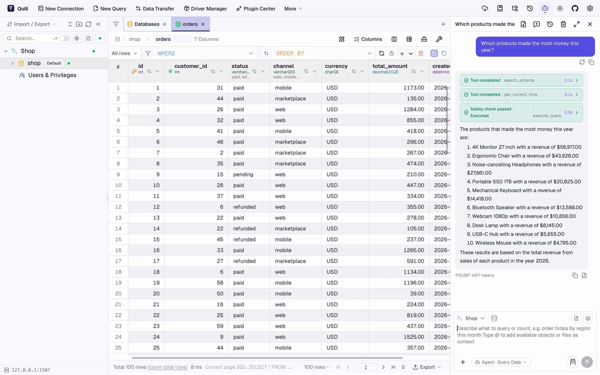
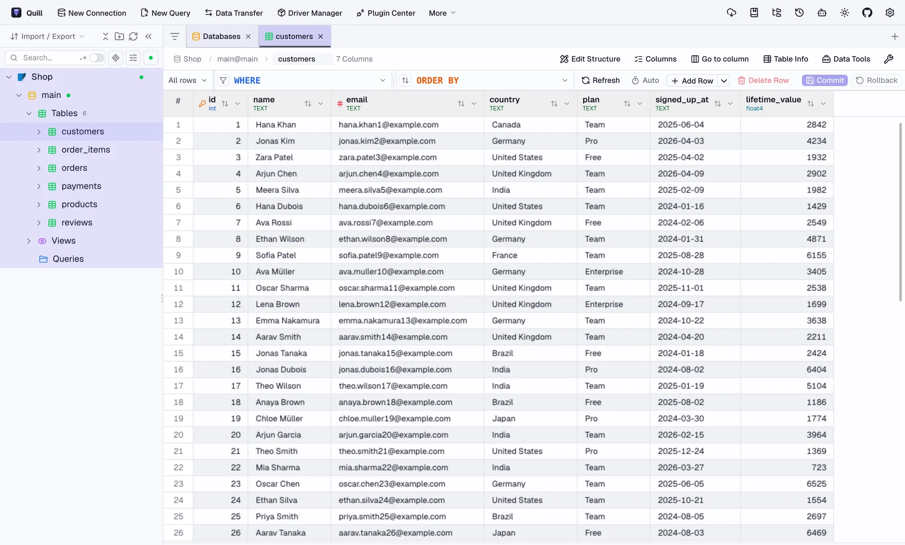
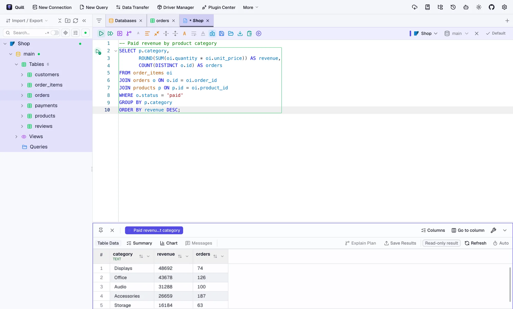
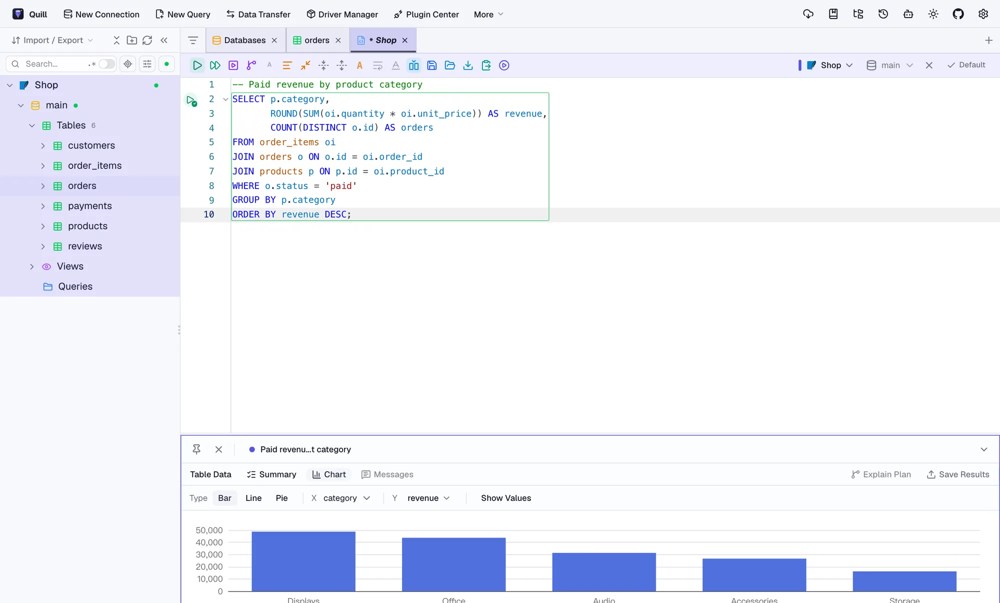
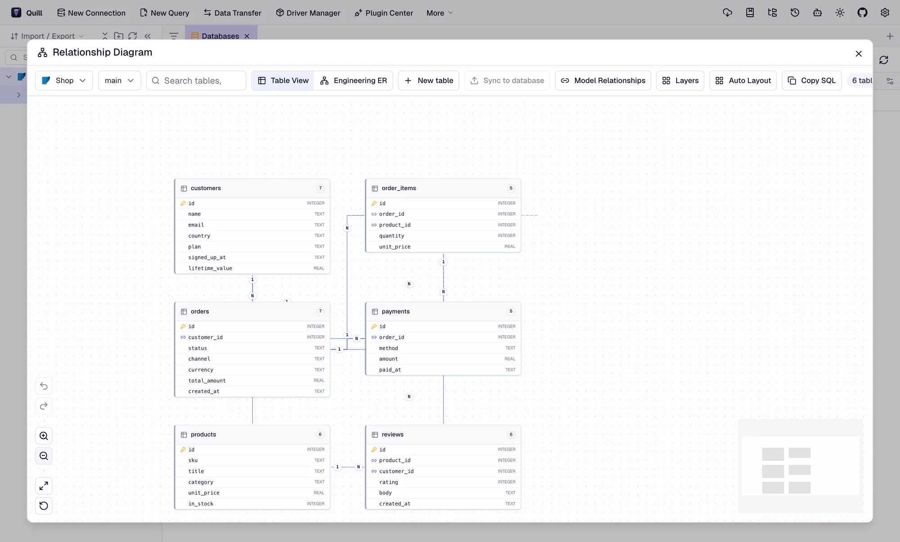

<div align="center">
  
  <h1>Quill</h1>
  <p><strong>Write your data in plain words.</strong></p>
  <p>A desktop database client for nearly 90 databases, with an AI assistant you can ask in plain English.<br />It finds the right tables, writes the SQL, checks it’s safe, runs it, and answers with real numbers.</p>
  <p>
    <a href="https://github.com/devops-monk/quill/releases/latest"></a>
    <a href="LICENSE"></a>
    <a href="https://github.com/devops-monk/quill/actions/workflows/ci.yml"></a>
  </p>
  <p>
    <a href="https://quill.devops-monk.com"><b>Website</b></a> ·
    <a href="https://github.com/devops-monk/quill/releases/latest"><b>Download</b></a> ·
    <a href="https://quill.devops-monk.com/tutorial/"><b>Get started guide</b></a>
  </p>
</div>

<p align="center">
  
</p>

## Ask your data a question

Open the assistant, type a question the way you’d ask a colleague, and Quill does the rest:

1. **Finds the right tables.** It matches your words to table names, columns and comments, and follows foreign keys to the tables that connect them, even ones you never mentioned.
2. **Writes SQL for your database.** MySQL, PostgreSQL, SQL Server, Oracle, SQLite, ClickHouse and more, each in its own dialect.
3. **Checks it’s safe, then runs it.** Read-only queries run straight away. Anything that would change data waits for your approval.
4. **Answers with real numbers,** and shows each step it took so you can check the work.

Two modes: **Ask** writes and explains SQL for you to run, and **Agent** explores the schema and runs read-only queries itself. For business questions, choose **Agent → Query Data**.

## Download

| Platform | Installer |
| --- | --- |
| macOS (Apple silicon and Intel) | `.dmg` |
| Windows (x64 and ARM) | `-setup.exe` or `.msi` |
| Linux (x64 and ARM64) | `.AppImage`, `.deb` or `.rpm` |

Get them from the [latest release](https://github.com/devops-monk/quill/releases/latest) or the [website](https://quill.devops-monk.com/#download). Installed copies update themselves from new releases.

> The first builds aren’t notarized by Apple or signed for Windows yet. On macOS, right-click Quill and choose **Open** the first time. On Windows, if SmartScreen appears, choose **More info**, then **Run anyway**.

New to Quill? The [get started guide](https://quill.devops-monk.com/tutorial/) walks through connecting MySQL, choosing an AI model and asking your first questions, with screenshots of every step.

## A full database client underneath

<table>
  <tr>
    <td width="50%"><br /><b>Browse and edit data.</b> Types, keys, filters and sorting. Edits stay pending until you commit.</td>
    <td width="50%"><br /><b>Write SQL.</b> Completion, formatting and explain plans for the database you pick.</td>
  </tr>
  <tr>
    <td width="50%"><br /><b>Chart results.</b> Turn any result into a bar, line or pie chart.</td>
    <td width="50%"><br /><b>See relationships.</b> Diagrams drawn from the real foreign keys.</td>
  </tr>
</table>

Also included: schema and data compare, data transfer between engines, import and export (CSV, Excel, JSON, SQL), SSH tunnels and TLS, backups, light and dark themes, and an MCP server so Claude Code and other agents can query your connections.

## Works with nearly 90 databases

PostgreSQL, MySQL, MariaDB, SQLite, SQL Server, Oracle, ClickHouse, DuckDB, Snowflake, BigQuery, Redshift, Databricks SQL, Trino, MongoDB, Redis, Elasticsearch, Cassandra, DynamoDB, Neo4j, InfluxDB, Qdrant, Milvus and many more, natively or through JDBC.

## Bring your own AI

Set it up under **Settings → AI → Add Config**:

| Service | How to connect |
| --- | --- |
| Claude | Provider **Claude** and an Anthropic API key |
| OpenAI | Provider **OpenAI** and an OpenAI API key |
| Ollama | Provider **Ollama**. Runs on your computer, so nothing leaves it |
| OpenRouter | Provider **OpenAI Compatible**, endpoint `https://openrouter.ai/api/v1` |
| LiteLLM and other gateways | Provider **OpenAI Compatible**, endpoint of your gateway |

Gemini, DeepSeek, Qwen and others have presets too, and any OpenAI- or Anthropic-style API works.

## Safe by default

- The assistant only reads data on its own. Changes need your approval, shown as the exact statement.
- Mark a connection read-only or production, and it stays that way.
- Finding tables happens on your computer. Only the tables a question needs go to your AI service, and with Ollama nothing leaves your machine.
- Smaller local models can make mistakes. Agent → Query Data makes the assistant run real queries, and every answer shows the steps behind it.

## Build from source

Requires Node.js 22.13+, pnpm 10 and a Rust toolchain.

```sh
pnpm install
pnpm dev:tauri        # run the desktop app
pnpm test             # frontend tests
pnpm typecheck
cargo test -p dbx-core --no-default-features --features sqlite-bundled
```

Rust tests need a larger stack: set `RUST_MIN_STACK=33554432`. Releases are built by [`.github/workflows/release.yml`](.github/workflows/release.yml) when a `v*` tag is pushed. The roadmap for the AI features is in [PLAN.md](PLAN.md).

## Credits and license

Quill is built on [DBX](https://github.com/t8y2/dbx) and adapts ideas from [DB-GPT](https://github.com/eosphoros-ai/DB-GPT). It’s licensed under the [Apache License 2.0](LICENSE). See [NOTICE](NOTICE) for details.
